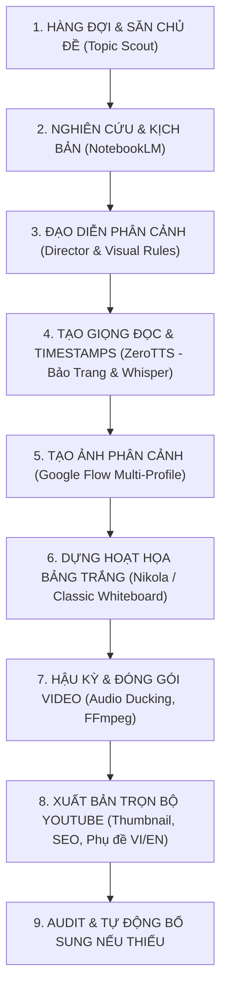

# PLAN.md – Kiến Trúc, Quy Trình & Kế Hoạch Vận Hành AutoVideo Studio

## 1. Mục Tiêu & Định Hướng Hệ Thống

AutoVideo Studio là hệ sinh thái desktop hoàn chỉnh vận hành tại `D:\AI\truyen\autovideo`, tự động hóa 100% quy trình sản xuất video hoạt họa bảng trắng (Whiteboard Animation) chuẩn triệu view:
- Tự động tìm kiếm chủ đề theo tin tức thời sự nóng và xu hướng YouTube.
- Tự động lập hồ sơ dữ kiện (Fact sheet) và viết kịch bản chuyên nghiệp bằng NotebookLM & Gemini.
- Tự động tạo ảnh phân cảnh qua cụm Google Flow đa profile song song.
- Dựng hoạt họa bảng trắng bằng nét vẽ tay thực tế (Nikola / Classic).
- Tự động xuất bản trọn bộ gói YouTube (Video, Thumbnail tin tức bắt mắt, Tiêu đề giật gân, Mô tả SEO song ngữ, Phụ đề song ngữ VI/EN).
- Hoạt động 24/7 không cần can thiệp tay, tối ưu tài nguyên tối đa (tận dụng CPU cho ZeroTTS, giải phóng VRAM GPU cho mô hình thị giác và render).

---

## 2. Toàn Bộ Chức Năng Đã Rà Soát & Bản Đồ Kiến Trúc

| Phân Hệ / Chức Năng | File Phụ Trách | Công Nghệ & Cơ Chế Hoạt Động |
|---|---|---|
| **Giao diện & Điều khiển** | `app/gui.py`, `app/api.py`, `app/web/` | Giao diện kết hợp PySide6 + Web UI (HTML5/CSS3/ES6 Matrix theme). Quản lý hàng đợi, xem trước video, chọn giọng, đổi độ dài (Short 8p / Chuẩn 12p / Sâu 15p / Mặc định 20p / Tùy chỉnh), kiểm tra tài nguyên GPU/VRAM/RAM. |
| **Tự tìm chủ đề (Topic Scout)** | `app/topic_scout.py`, `app/websearch.py` | Tìm kiếm tin nóng từ DuckDuckGo/Google News, phân tích xu hướng và tự động bổ sung vào hàng đợi. Luôn đảm bảo duy trì tối thiểu 10 chủ đề trong hàng đợi. |
| **Nghiên cứu & Kịch bản** | `app/research.py`, `app/notebook.py` | Kết nối extension Notebook Bridge, tạo sổ mới tự động, trích xuất dữ kiện thực tế từ web/tài liệu, viết dàn ý 8 chương bám sát nhịp điệu kể chuyện cuốn hút. |
| **Đạo diễn phân cảnh (Director)** | `app/director.py`, `app/visual_rules.py` | Gemini Web Bridge (ưu tiên) hoặc Qwen3-VL (fallback). Chia cảnh chuẩn nhịp thời gian, sinh lời đọc và prompt vẽ tranh. Tự động nhận diện chân dung người thật, vẽ số liệu và quốc kỳ chuẩn xác. |
| **Tạo giọng đọc (TTS) & ASR** | `app/tts.py`, `app/normalizer.py`, `app/audio_qc.py` | **ZeroTTS (CPU ONNX, 48 kHz)** với giọng mặc định **Bảo Trang** (`baotrang`), tốc độ cực nhanh (~50x realtime). Chuẩn hóa số, ngày, tiền, đơn vị đo. Whisper large-v3-turbo tự động kiểm tra lời đọc và trích xuất timestamp từng từ. |
| **Sinh hình ảnh đa Profile** | `app/autoflow.py`, `app/flowbridge.py`, `chrome_ext/` | Điều phối hàng đợi ảnh phân tán qua các profile Google Flow song song. Tự động phát hiện lỗi và phục hồi tab sạch. |
| **Kiểm định chất lượng ảnh (Visual QC)** | `app/visual_qc.py`, `app/complexity.py`, `app/variety.py` | Dùng mô hình thị giác Qwen3-VL kiểm tra ảnh: loại bỏ ảnh rác, ảnh hỏng, kiểm tra mật độ nét vẽ tay, đảm bảo tính đa dạng góc nhìn. |
| **Dựng hoạt họa Whiteboard** | `app/render.py`, `app/styles/nikola.py`, `app/canvas.py` | Hỗ trợ 2 phong cách: Classic (mỗi cảnh một clip) và Nikola (bảng hai đảo semantic, nét vẽ tay mực thực tế, phóng to thu nhỏ và chữ khóa dải giấy). |
| **Hậu kỳ & Lắp ráp (Assemble)** | `app/render.py`, `app/transition.py` | Ghép video, hiệu ứng chuyển cảnh mượt mà, lồng nhạc nền tự động giảm âm khi có lời đọc (audio ducking), chuẩn hóa âm lượng theo chuẩn YouTube (-16 LUFS). |
| **Xuất bản YouTube Trọn Gói** | `app/youtube.py`, `app/thumbnail.py`, `app/subtitles.py` | Sinh trọn bộ: Tiêu đề (5 phương án), Mô tả chuẩn SEO (kèm mốc chương thật 00:00), Thẻ tags, 6 biến thể Thumbnail tin tức thời sự (chữ vàng viền đen khối nền mờ + huy hiệu ngày), phụ đề song ngữ VI/EN chuẩn YouTube. |
| **Tự động Bổ sung Thiếu (Audit)** | `app/youtube.py` (`audit_and_fix_all`), `app/api.py` | Nút bấm **`🩺 Kiểm tra & Bổ sung thiếu`** quét toàn bộ dự án đã xong, tự động nhận diện và hoàn thiện ngay lập tức bất kỳ file nào còn thiếu. |
| **Tự động Phục Hồi (Auto Resume)** | `auto_resume_watcher.py`, `Chay_Auto_Resume.bat` | Tiến trình ngầm tự động bấm tiếp tục cho các extension ngay sau khi giải captcha hoặc sau khi hết giới hạn chờ, duy trì vòng lặp 20 giây ổn định. |

---

## 3. Quy Trình Vận Hành Pipeline Chi Tiết

---

## 4. Kế Hoạch Nâng Cấp & Tối Ưu Hóa Tiếp Theo

1. **Nâng cao khả năng bám chủ đề**:
   - Tối ưu hóa prompt kịch bản NotebookLM để tăng cường các chi tiết mâu thuẫn kịch tính và số liệu dẫn chứng trong 60 giây đầu tiên (Hook tỷ lệ giữ chân cao).
2. **Mở rộng đa dạng hóa hình ảnh**:
   - Nâng cấp thư viện bố cục của Đạo diễn phân cảnh, tự động kết hợp góc máy cận cảnh (close-up) khuôn mặt nhân vật và góc nhìn toàn cảnh (wide shot) bối cảnh địa chính trị.
3. **Giám sát thông minh**:
   - Tiếp tục duy trì watcher `auto_resume_watcher.py` và nút bấm kiểm toán trên Web UI để hệ thống luôn trong trạng thái tự phục hồi cao nhất.
